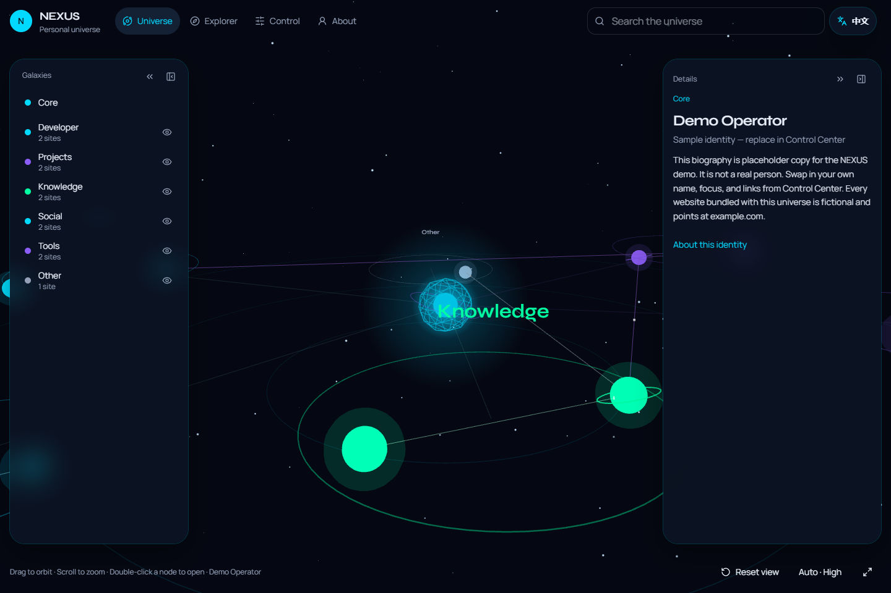
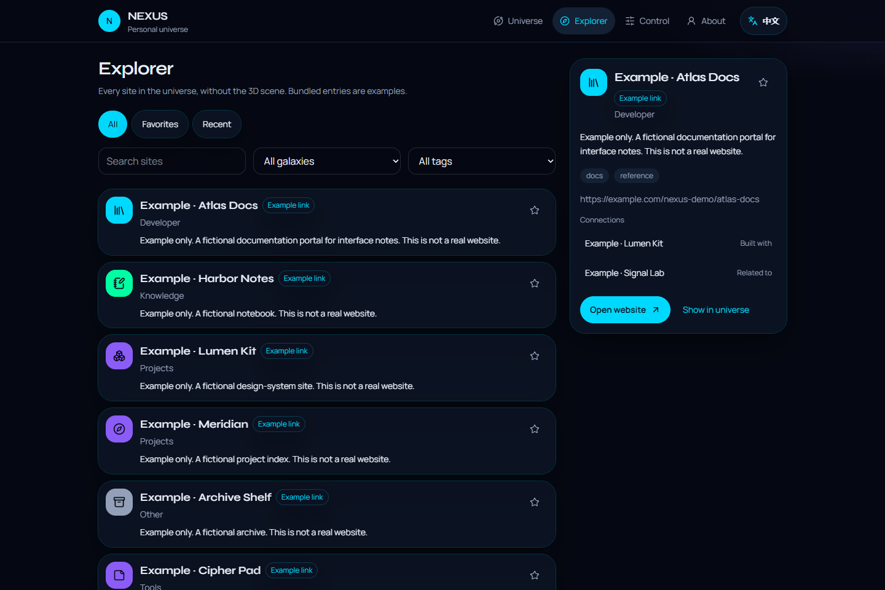

# NEXUS · Personal Digital Universe

> **由 GROK加DEEPSEEK完全构建**
>
> Built entirely by GROK + DeepSeek.

[中文](README.md) | **English**

**Demo:** https://nexus.fluentic.cn (live after the Vercel deploy and domain binding) · **Repo:** https://github.com/YingLi-kid/NEXUS

A 3D star map for your sites, projects, notes, and identity — drag to orbit, scroll to zoom, double-click to open. Ships with English/Chinese bilingual UI, a visual control center, local persistence, and a ready-to-deploy Vercel setup. No backend required.

`React 19` · `TanStack Start` · `Vite 8` · `Tailwind CSS 4` · `three.js` · `TypeScript` · `Zustand`





---

## Contents

1. [Overview](#1-overview)
2. [Features](#2-features)
3. [Tech Stack](#3-tech-stack)
4. [Requirements](#4-requirements)
5. [Quick Start](#5-quick-start)
6. [Commands](#6-commands)
7. [Project Layout](#7-project-layout)
8. [Usage](#8-usage)
9. [Data and Persistence](#9-data-and-persistence)
10. [Editing Default Content](#10-editing-default-content)
11. [Bilingual Implementation](#11-bilingual-implementation)
12. [Deploying to Vercel](#12-deploying-to-vercel)
13. [Troubleshooting](#13-troubleshooting)
14. [File Map](#14-file-map)
15. [Security and Privacy](#15-security-and-privacy)
16. [Build Credit](#16-build-credit)

---

## 1. Overview

NEXUS is a **personal digital universe**:

- **Universe** — a 3D star map. The **Core** at the center is your identity; around it sit **galaxies** (categories), each holding **sites** (websites, projects, notes), with visible **links** between sites.
- **Explorer** — the same content as a flat list, no 3D required. Good for low-end devices, quick search, and everyday browsing.
- **Control Center** — add, edit, and delete sites, galaxies, links, and identity right in the browser. Changes apply instantly.
- **About** — bio, featured work, galaxy overview, and contact links.

The default content is fictional `Demo Operator` data pointing at `example.com`; it contains no real personal information. Replace it in the Control Center or edit the seed file directly.

The default language is English; the top-right toggle switches to Chinese instantly and remembers the choice per browser.

---

## 2. Features

**3D universe**

- Galaxies, sites, and links are fully data-driven; position, color, and strength are editable
- Drag to orbit, scroll to zoom, double-click a node to open its site
- Auto / High / Low quality tiers, fullscreen, one-click view reset
- Graceful fallback when WebGL is unavailable; Explorer and Control Center keep working
- Boot loading animation and error retry

**Bilingual (English / Chinese)**

- UI copy, page titles, meta description, error pages, 3D scene labels, and auth buttons all follow the language toggle
- Content (site names, descriptions, tags, categories, bio, social buttons) supports Chinese too
- In Chinese mode the Control Center exposes a **Chinese copy** form; leave it empty to fall back to English

**Explorer**

- All / Favorites / Recent views
- Keyword search matches both English and Chinese fields
- Filter by galaxy and by tag; sorting uses localized names
- Card details, favorites, open-site, and locate-in-universe actions

**Control Center**

- Sites: name, URL, description, galaxy, tags, cover, icon, position, featured, visibility, English + Chinese copy
- Galaxies: name, description, color, position, English + Chinese copy
- Links: source, target, relation type (belongs-to / related-to / built-with), strength
- Identity: name, role, bio, focus areas, email, location, social pages
- Data: export / import JSON, restore demo data
- Every edit auto-saves with validation and inline errors

**Panels and interaction**

- Left and right panels have three states: expanded (default) / compact / hidden, with a glass handle at the screen edge when hidden
- Panel state is remembered per panel
- Responsive layout for phone / tablet / desktop
- Keyboard shortcuts: `/` or `Ctrl/Cmd + K` to search, `Esc` to close, `0` to reset the view

**Data and deployment**

- Data lives in browser `localStorage`; survives refresh and restart
- Seed fingerprint: a new deploy replaces stale caches; offline visitors keep the local copy
- Export JSON for backup, import to restore
- Nitro `vercel` preset: one `npm run build` produces the Vercel Build Output
- Optional auth and database: off by default; universe data never needs a database

---

## 3. Tech Stack

| Layer | Choice |
| --- | --- |
| Framework | React 19 + TanStack Start / TanStack Router |
| Build | Vite 8 + Nitro 3 (`vercel` preset) |
| Language | TypeScript 5.7 (`strict`) |
| Styling | Tailwind CSS 4 + custom `@theme` tokens + glassmorphism |
| State | Zustand 5 + `persist` (localStorage) |
| 3D | three.js + @react-three/fiber + @react-three/drei |
| Validation | Zod 4 |
| Icons | lucide-react |
| Optional backend | Better Auth + Kysely + Neon / PGLite |
| Testing | Node Test Runner + Playwright (browser checks) |

---

## 4. Requirements

- **Node.js 22.x** (`package.json` pins `engines.node = 22.x`)
- **npm 10+** (the repo ships `package-lock.json`)
- A modern browser: Chrome / Edge / Firefox / Safari, WebGL2 recommended
- Windows / macOS / Linux; on Windows use PowerShell

Check versions:

```powershell
node -v
npm -v
```

> On Windows the project starts through `scripts/with-app-env.mjs`, which already handles `spawn vite ENOENT` and injects `node_modules/.bin` into `PATH`. No manual PATH work needed.

---

## 5. Quick Start

```powershell
git clone https://github.com/YingLi-kid/NEXUS.git
cd NEXUS
npm install
npm run dev
```

Open:

**http://localhost:8080**

On first launch the demo seed loads. Once the 3D universe appears:

1. Click `中文` in the top-right to switch the UI to Chinese
2. The left panel lists galaxies; the right panel shows details
3. To edit content, open the **Control** page

Stop the server with `Ctrl + C`.

Production build and local preview:

```powershell
npm run build
npm run preview
```

Preview URL: **http://localhost:8081**

> Run `npm run build` first — `npm run preview` serves the production output from `.vercel/output`.

No login, no database, and no API key are required by default.

---

## 6. Commands

| Command | What it does |
| --- | --- |
| `npm run dev` | Dev server on `0.0.0.0:8080` with hot reload |
| `npm run build` | Production build into `.vercel/output`, then runs `db:migrate` |
| `npm run preview` | Preview the production build on `127.0.0.1:8081` |
| `npm run preview:restart` / `npm run preview:stop` | Restart / stop the background preview process |
| `npm run typecheck` | Full type check via `tsc --noEmit` |
| `npm run lint` | ESLint |
| `npm run format` | Prettier |
| `npm test` | Unit and script tests (Node Test Runner) |
| `npm run check:auth` | Auth-switch consistency check |
| `npm run db:migrate` | Database migrations; skipped automatically when `DATABASE_URL` is unset |

At the end of `npm run build` you may see:

```text
[migrate] DATABASE_URL not set — skipping (the PGLite fallback migrates itself).
```

That is **expected**: the project is on the no-database PGLite fallback path.

---

## 7. Project Layout

```text
NEXUS/
├─ public/
│  ├─ data/nexus.json          ← demo seed: profile / galaxies / sites / links (editable)
│  ├─ __grok/                  ← static assets for the platform PWA install page
│  └─ og.jpg etc.              ← social share image and icons
├─ src/
│  ├─ routes/
│  │  ├─ __root.tsx            ← root layout: nav, language, title/meta sync
│  │  ├─ index.tsx             ← / (Universe)
│  │  ├─ explorer.tsx          ← /explorer (Explorer)
│  │  ├─ control.tsx           ← /control (Control Center)
│  │  └─ about.tsx             ← /about (About)
│  ├─ features/
│  │  ├─ universe/             ← 3D page and HUD (left rail, details, search, panel switches)
│  │  ├─ explorer/             ← Explorer list, filters, favorites
│  │  ├─ control/              ← Control Center and editors
│  │  └─ about/                ← About page
│  ├─ universe/                ← three.js scene: starfield, nodes, links, camera, geometry
│  ├─ components/
│  │  ├─ shell/                ← top bar, brand, language toggle
│  │  ├─ site/                 ← site cards, details, icon whitelist
│  │  └─ ui/                   ← base buttons and primitives
│  ├─ stores/nexus-store.ts    ← Zustand state, localStorage persistence, seed fingerprint
│  ├─ services/
│  │  ├─ seed.ts               ← reads /data/nexus.json
│  │  └─ nexus-schema.ts       ← Zod data validation
│  ├─ lib/
│  │  ├─ i18n.ts               ← all UI copy (EN/ZH dictionary + error phrase translation)
│  │  ├─ localize.ts           ← data-level language picking and fallback
│  │  ├─ use-i18n.ts           ← language hook
│  │  ├─ error-component.tsx   ← error page
│  │  └─ auth/                 ← optional sign-in (off by default)
│  ├─ types/nexus.ts           ← data model (including optional …Zh fields)
│  └─ styles.css               ← Tailwind 4 theme tokens, glass, page backgrounds
├─ server/middleware/grok-pwa.ts ← PWA manifest / install guide / head injection
├─ scripts/                    ← startup wrapper, migrations, PWA, checks, preview scripts
├─ migrations/                 ← optional database migrations
├─ screenshots/                ← README and verification screenshots
├─ .grok/app-env.json          ← platform defaults (VITE_AUTH_ENABLED=false)
├─ vite.config.ts              ← Vite / TanStack Start / Nitro / PWA config
├─ vercel.json                 ← Vercel install command
├─ package.json                ← scripts and dependencies
├─ README.md                   ← Chinese README
└─ README.en.md                ← this file
```

---

## 8. Usage

### 8.1 The four pages

| Path | Page | Description |
| --- | --- | --- |
| `/` | Universe | 3D star map |
| `/explorer` | Explorer | Flat list with search / filters / favorites |
| `/control` | Control Center | Edit sites, galaxies, links, identity, data |
| `/about` | About | Bio and contact details |

Use the top bar — **Universe / Explorer / Control / About** — to switch anytime. The top-right holds the language toggle plus quality / fullscreen controls.

### 8.2 Language switching

- Click `中文` / `EN` in the top-right; it applies instantly and is remembered
- Chinese mode switches UI buttons, page titles, meta description, error messages, 3D scene labels, site data, and the Control Center's Chinese forms
- Chinese content is optional; missing Chinese falls back to English, never to a blank field

### 8.3 3D controls

| Action | Result |
| --- | --- |
| Drag | Orbit the camera |
| Scroll / two-finger | Zoom |
| Double-click a node | Open site details or focus it |
| Click empty space | Clear selection |
| Bottom-left "Reset view" / `0` | Return to the default camera |
| Bottom-right quality | Auto (device-based) / High / Low |
| Bottom-right fullscreen | Enter / exit fullscreen |

Nodes: the **Core** in the center is your identity; outer **galaxies** are color-coded categories; spheres inside a galaxy are sites; thin lines are links — the brighter the line, the stronger the relation.

### 8.4 Left and right panels

- Both panels start **expanded** on first visit
- Left panel top-right button: compact → hidden; when hidden, a glass handle appears at the left screen edge — click it to restore
- Right panel works the same from its top-left button
- Each panel remembers its own state across refreshes

### 8.5 Explorer

1. Switch views at the top: **All / Favorites / Recent**
2. Search by site name, description, tag, or domain — English and Chinese both match
3. Filter with the **All galaxies** and **All tags** dropdowns
4. Click a card for details on the right; star it to favorite; open the site or locate it in the universe

### 8.6 Control Center

**Sites**

1. Click **Add site**
2. Fill in name, URL (must be `http://` or `https://`), description, galaxy, tags (comma-separated, up to 12)
3. Optionally set a cover image URL, icon, and local position
4. Tick **Featured node** / **Visible in the universe**
5. In Chinese mode a **Chinese copy** block appears: Chinese name, description, and tags; leave empty to fall back to English
6. Edits auto-save; the footer shows "Saved in this browser."

**Galaxies**

- Name, description, color (`#rrggbb`), position; Chinese copy works the same way
- Keep at least one galaxy; a galaxy that still contains sites cannot be deleted

**Links**

- Pick source, target, type (belongs-to / related-to / built-with), and strength
- The two ends must differ; duplicate links of the same type are rejected

**Identity**

- Name, role, bio, focus areas (comma-separated), email, location
- Social pages: label + `http(s)` URL, add or remove freely
- Chinese mode accepts Chinese role, bio, focus areas, location, and social labels

**Data**

- **Export JSON**: download a full backup of the current universe
- **Import JSON**: replace current data from a file (format is validated)
- **Restore demo data**: return to the bundled demo after confirmation

### 8.7 Shortcuts

| Key | Action |
| --- | --- |
| `/` or `Ctrl/Cmd + K` | Open and focus search |
| `Esc` | Close search / details; blur an input |
| `0` | Reset the 3D view |

(Shortcuts are ignored while typing in an input or textarea.)

---

## 9. Data and Persistence

### 9.1 Where data lives

- Key: `nexus-universe-v1` in `localStorage`
- Stores: profile, galaxies, sites, links, favorites, recents, hidden galaxies, quality, language, panel states, and the seed fingerprint
- Survives refresh, browser restart, and reboot; lost when switching browsers/devices or clearing storage

### 9.2 Seed and fingerprint

Boot sequence:

1. Read `public/data/nexus.json` (the seed)
2. Compute a stable fingerprint over profile, galaxies, sites, links, and English/Chinese fields
3. Compare it with `seedKey` in localStorage
4. Same fingerprint → use the local cache (your edits survive)
5. Different fingerprint (new deploy or edited seed) → the file replaces local data
6. Seed fetch fails with a local cache → keep using the cache; without one → show an error and **Try again**

This means **a new deploy overwrites visitors' old demo data**. Export JSON first if you want to keep edits.

### 9.3 Reset local data

In the app: Control Center → Data → Restore demo data.

In the browser console:

```js
localStorage.removeItem("nexus-universe-v1");
location.reload();
```

### 9.4 Backups

Export JSON before large edits; import the same file on another device to migrate.

---

## 10. Editing Default Content

Two ways:

| Method | Best for | Scope |
| --- | --- | --- |
| Control Center | Day-to-day edits, experiments | Current browser only |
| Edit `public/data/nexus.json` | Making **every visitor** see the same content | Global after rebuild / deploy |

The dev server hot-reloads the seed; production needs `npm run build` and a redeploy.

### 10.1 Data structure

```json
{
  "version": 1,
  "profile": {
    "name": "Demo Operator",
    "role": "Sample identity — replace in Control Center",
    "roleZh": "示例身份 — 请在控制中心替换",
    "bio": "Placeholder biography.",
    "bioZh": "占位简介。",
    "focus": ["Interface systems"],
    "focusZh": ["界面系统"],
    "email": "operator@example.com",
    "location": "Example City",
    "locationZh": "示例城市",
    "socials": [
      {
        "id": "soc-home",
        "label": "Example home",
        "labelZh": "示例主页",
        "url": "https://example.com/nexus-demo"
      }
    ]
  },
  "categories": [
    {
      "id": "developer",
      "name": "Developer",
      "nameZh": "开发",
      "description": "Example docs and experiments.",
      "descriptionZh": "示例文档与实验。",
      "color": "#00d9ff",
      "position": [-16, 1.2, -2]
    }
  ],
  "websites": [
    {
      "id": "ex-atlas",
      "name": "Example · Atlas Docs",
      "nameZh": "示例 · 图谱文档",
      "url": "https://example.com/nexus-demo/atlas-docs",
      "description": "Example only.",
      "descriptionZh": "仅为示例。",
      "categoryId": "developer",
      "tags": ["docs", "reference"],
      "tagsZh": ["文档", "参考"],
      "icon": "Library",
      "cover": "",
      "featured": true,
      "visible": true,
      "createdAt": "2026-01-08T00:00:00.000Z",
      "position": [3.3, 0.5, 11]
    }
  ],
  "connections": [
    {
      "id": "link-atlas-lumen",
      "sourceId": "ex-atlas",
      "targetId": "ex-lumen",
      "type": "related-to",
      "strength": 0.45
    }
  ]
}
```

### 10.2 Constraints

- `version` is always `1`
- All `id` values are unique within their collection; both ends of a link must exist
- URLs and covers accept only `http://` / `https://`; covers may be empty
- Colors must be `#rrggbb`
- Tags and focus areas are capped at 12 each
- `categoryId` must point at an existing galaxy
- Keep at least one galaxy; move or delete its sites before deleting a galaxy
- Links cannot self-reference or duplicate the same type

### 10.3 Icon whitelist (16)

```text
Archive  BookOpen  Boxes  Compass  Cpu  FlaskConical  Gauge  Globe
Library  Mail  NotebookPen  Share2  StickyNote  Telescope  UserRound  Wrench
```

Any other name falls back to `Globe` without an error.

### 10.4 Relation types

```text
belongs-to   Belongs to
related-to   Related to
built-with   Built with
```

### 10.5 Can I still edit after deploying?

Yes, in two different senses:

- **Edits in your own browser** apply instantly and affect only that browser — good for previewing and private curation
- **Changes for every visitor** require editing `public/data/nexus.json`, rebuilding, and redeploying

A deployed site is a static seed plus front-end editing; Control Center changes are not synced to the server. Sharing one dataset across many people needs a database or API.

---

## 11. Bilingual Implementation

Three layers:

| Layer | File | Responsibility |
| --- | --- | --- |
| UI copy | `src/lib/i18n.ts` | Buttons, titles, hints, error sentences, meta, auth, 3D labels |
| Data selection | `src/lib/localize.ts` | Language-aware picking and fallback for sites, categories, profile, socials |
| Data content | `public/data/nexus.json` | English base plus optional Chinese (`…Zh` fields) |

Chinese fields available in data:

| Object | Fields |
| --- | --- |
| Profile | `roleZh` `bioZh` `focusZh` `locationZh` |
| SocialLink | `labelZh` |
| Category | `nameZh` `descriptionZh` |
| Website | `nameZh` `descriptionZh` `tagsZh` |

Rules:

- English base fields are required; Chinese fields are optional
- Empty or missing Chinese falls back to English
- `focusZh` and `tagsZh` pair with the English arrays by index; short arrays fall back per item
- In Chinese mode the Control Center exposes a **Chinese copy** form; empty means fallback

Adding a UI string:

1. Add a `key: { en, zh }` entry to `DICT` in `src/lib/i18n.ts`
2. In a component, use `const { t } = useI18n()` and call `t("key")`
3. English sentences thrown outside React need a mapping in `PHRASES_ZH` or `SCHEMA_PATTERNS_ZH`

To make Chinese the default language, change `lang: "en"` to `lang: "zh"` in the initial state of `src/stores/nexus-store.ts`. Browsers that have already visited keep their locally saved language until `nexus-universe-v1` is cleared.

> The platform's iOS install guide (`?install=1`, injected by `server/middleware/grok-pwa.ts`) is a static English template page, not part of the site UI. To localize it, edit `scripts/install-page.html`.

---

## 12. Deploying to Vercel

### 12.1 Clone and push from GitHub

```powershell
git clone https://github.com/YingLi-kid/NEXUS.git
cd NEXUS
# after editing files
git add .
git commit -m "Update NEXUS"
git push
```

`.gitignore` already excludes `node_modules/`, `.vercel/`, `*.log`, and `.env*`, so dependencies and secrets stay out of the repo.

### 12.2 Vercel dashboard

1. Vercel → Add New → Project → pick this repository
2. **Framework Preset**: `Other`
3. **Build Command**: `npm run build`
4. **Output Directory**: leave blank (Nitro writes `.vercel/output`; if the UI insists, enter `.vercel/output`)
5. **Node.js Version**: `22.x`
6. Environment variables: none required by default
7. Deploy

### 12.3 Vercel CLI

```powershell
npm i -g vercel
vercel login
cd NEXUS
vercel link
vercel --prod
```

If the CLI asks for build settings, use the Build Command / Output Directory / Node 22 values above.

### 12.4 Build output

`npm run build` produces:

```text
.vercel/output/
├─ config.json          ← routing rules: static assets / filesystem / everything else to the function
├─ nitro.json
├─ static/              ← front-end static assets (~1.9 MB)
└─ functions/
   └─ __server.func/    ← Nitro server function (~4 MB, includes PWA injection)
```

The directory uploaded to Vercel is **`.vercel/output`**.

### 12.5 Environment variables (all optional)

| Variable | Default | Purpose |
| --- | --- | --- |
| `VITE_AUTH_ENABLED` | `false` (`.grok/app-env.json`) | Enable sign-in; `false` uses the built-in dev user |
| `DATABASE_URL` | unset | Enables Postgres (Neon); unset uses the in-memory PGLite fallback |
| `BETTER_AUTH_URL` | inferred | Public Better Auth URL (needed when sign-in is enabled) |
| `BETTER_AUTH_SECRET` | preview-only secret | Must be set explicitly for production sign-in |
| `GROK_AUTH_ISSUER` / `GROK_AUTH_CLIENT_ID` / `GROK_AUTH_CLIENT_SECRET` | preview defaults | Platform auth broker (needed when sign-in is enabled) |

For a personal showcase site: **none of these are needed**.

### 12.6 Bind the demo domain `nexus.fluentic.cn`

1. Vercel project → Settings → Domains → add `nexus.fluentic.cn`
2. At DNSPod, create a CNAME record: host `nexus`, type `CNAME`, value `cname.vercel-dns.com` (use the target Vercel shows if it differs)
3. Wait for DNS to propagate; Vercel issues the HTTPS certificate automatically
4. Visit **https://nexus.fluentic.cn**

> `fluentic.cn` already resolves; the `nexus` host record does not exist yet. Add it in both Vercel and DNSPod after deploying. The GitHub repository Website field points here as well.

---

## 13. Troubleshooting

**Q1. `npm run dev` fails with `spawn vite ENOENT`?**

The project already wraps startup in `scripts/with-app-env.mjs`, so this should not happen. If it does:

```powershell
Remove-Item node_modules -Recurse -Force
npm install
npm run dev
```

Also confirm `node -v` is `v22.x`.

**Q2. Port 8080 is busy?**

```powershell
Get-NetTCPConnection -LocalPort 8080 -State Listen | ForEach-Object { Stop-Process -Id $_.OwningProcess -Force }
npm run dev
```

**Q3. `npm run preview` will not open?**

Run `npm run build` first, then `npm run preview`. The preview port is `8081`, not `8080`.

**Q4. Some text is still English?**

- Confirm the top-right toggle is on **中文**
- Data without Chinese falls back to English; fill in the **Chinese copy** in the Control Center
- URLs, emails, the `NEXUS` brand, and the language button's own `English` label are intentionally untranslated

**Q5. Edited `nexus.json` but a refresh shows no change?**

The browser still holds the old cache. Press `Ctrl + Shift + R`; or use Control Center → Restore demo data; or run:

```js
localStorage.removeItem("nexus-universe-v1");
location.reload();
```

**Q6. The 3D area is black / says 3D view unavailable?**

WebGL is disabled on the browser or GPU. Try the **Low** quality setting; if it still fails, use Explorer — all features remain available.

**Q7. `npm run build` prints `DATABASE_URL not set — skipping`?**

Expected. Universe data does not use the database; the line only means the optional migration was skipped.

**Q8. PowerShell blocks `npm.ps1`?**

Use:

```powershell
npm.cmd run dev
```

Or set the execution policy to `RemoteSigned` (requires admin).

**Q9. Do Control Center edits reach the server?**

No. They stay in the current browser. To publish them globally, edit the seed file and redeploy (see Section 10).

---

## 14. File Map

| I want to change… | Go to… |
| --- | --- |
| UI copy / errors / page titles | `src/lib/i18n.ts` |
| Language picking and fallback rules | `src/lib/localize.ts` |
| Default demo content (global) | `public/data/nexus.json` |
| Data model (new fields) | `src/types/nexus.ts` |
| Data validation rules | `src/services/nexus-schema.ts` |
| Local persistence / seed fingerprint / state actions | `src/stores/nexus-store.ts` |
| 3D scene, nodes, links, camera | `src/universe/*` |
| Left rail / right panel / search / panel states | `src/features/universe/UniverseHud.tsx` |
| Explorer list and filters | `src/features/explorer/ExplorerPage.tsx` |
| Control Center and editors | `src/features/control/*` |
| About page | `src/features/about/AboutPage.tsx` |
| Routes and page entry points | `src/routes/*` |
| Theme colors, glass, page backgrounds | `src/styles.css` |
| Icon whitelist | `src/components/site/icons.tsx` |
| PWA / manifest / install page | `server/middleware/grok-pwa.ts` |
| Startup wrapper (Windows compatibility) | `scripts/with-app-env.mjs` |
| Build / deploy settings | `vite.config.ts`, `vercel.json`, `package.json` |

---

## 15. Security and Privacy

- Default content is **fictional demo data**, contains no real personal information, and points at `example.com`
- Universe data stays in browser `localStorage` and is never uploaded
- Sign-in is off by default; accounts and databases only come into play when auth is enabled
- Never commit `.env`, database URLs, or OAuth secrets (`.gitignore` already excludes `.env*`)
- External links are protocol-checked; only `http` / `https` can be opened
- No analytics, tracking pixels, or third-party telemetry are built in

---

## 16. Build Credit

**This project was built entirely by GROK + DeepSeek.**

**本项目由 GROK加DEEPSEEK完全构建。**

- Product concept, interface design, 3D scene, bilingual system, Control Center, and deployment setup: built by GROK + DeepSeek
- Based on the Grok App Builder TanStack Start template
- Open-source dependencies: React, TanStack, Vite, Tailwind CSS, three.js, Zustand, Zod, lucide-react, and more (see `package.json`)

The repository does not currently include a `LICENSE` file. Before publishing, add MIT or Apache-2.0 and keep this build credit.

---

> **由 GROK加DEEPSEEK完全构建** · Built entirely by GROK + DeepSeek. · NEXUS · Personal Digital Universe
