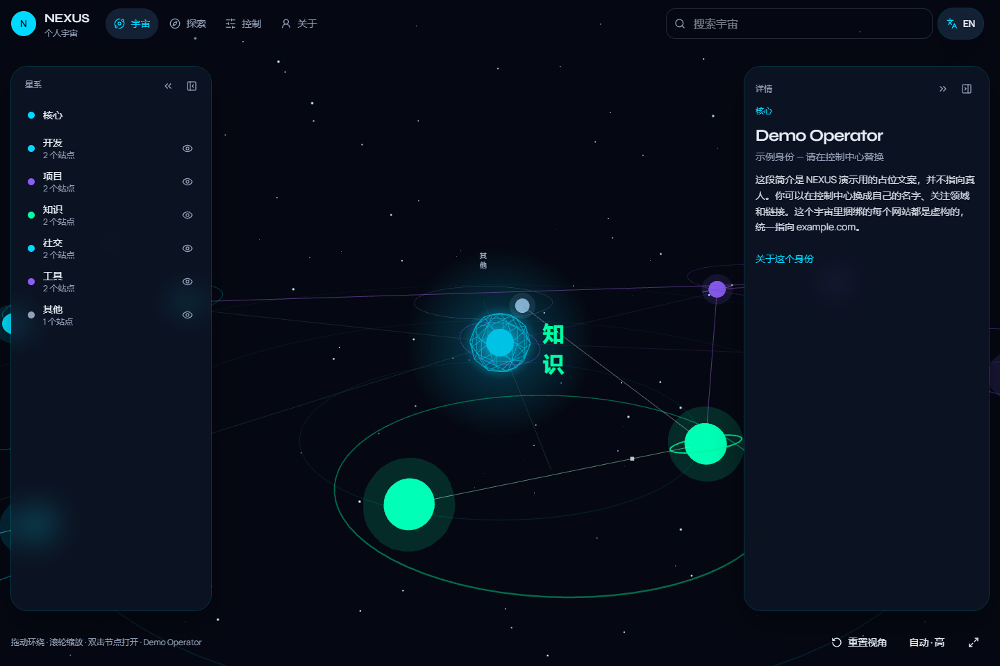
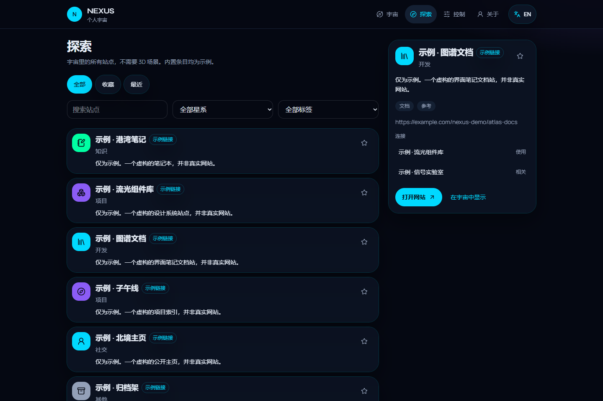

# NEXUS · 个人数字宇宙

**中文** | [English](README.en.md)

**仓库：** https://github.com/YingLi-kid/NEXUS

> **由 GROK加DEEPSEEK完全构建**
>
> Built entirely by GROK + DeepSeek.

把站点、项目、笔记和身份收进一张可以拖拽、缩放、双击打开的 3D 星图。自带中英双语、可视化控制台、本地持久化和 Vercel 部署配置，不需要后端也能完整运行。

`React 19` · `TanStack Start` · `Vite 8` · `Tailwind CSS 4` · `three.js` · `TypeScript` · `Zustand`





---

## 目录

1. [项目简介](#1-项目简介)
2. [功能清单](#2-功能清单)
3. [技术栈](#3-技术栈)
4. [环境要求](#4-环境要求)
5. [快速开始](#5-快速开始)
6. [常用命令](#6-常用命令)
7. [目录结构](#7-目录结构)
8. [使用说明](#8-使用说明)
9. [数据与持久化](#9-数据与持久化)
10. [修改默认内容](#10-修改默认内容)
11. [中英双语实现](#11-中英双语实现)
12. [部署到 Vercel](#12-部署到-vercel)
13. [常见问题](#13-常见问题)
14. [重要文件速查](#14-重要文件速查)
15. [安全与隐私](#15-安全与隐私)
16. [构建声明与致谢](#16-构建声明与致谢)

---

## 1. 项目简介

NEXUS 是一个**个人数字宇宙**站点：

- **宇宙（Universe）**：3D 星图。中心是「核心」（你的身份），周围是一颗颗「星系」（分类），星系里挂着一颗颗「站点」（网站 / 项目 / 笔记），站点之间有可见的「连接」。
- **探索（Explorer）**：同一批内容的平面列表，不依赖 3D，适合低配设备、快速检索和日常浏览。
- **控制中心（Control）**：在浏览器里直接增删改站点、星系、连接和身份，改完立即生效。
- **关于（About）**：个人介绍、精选作品、星系总览与联系方式。

默认数据是虚构的 `Demo Operator` 演示内容，全部指向 `example.com`，没有任何真实个人信息；换成自己的内容只需要在控制中心改，或直接改种子文件。

默认语言为英文，右上角可一键切换中文；语言选择会记在本机。

---

## 2. 功能清单

**3D 宇宙**

- 星系、站点、连线全部由数据驱动，位置、颜色、强度可调
- 拖拽环绕、滚轮缩放、双击节点打开站点
- 自动 / 高 / 低三档画质，支持全屏，一键重置视角
- WebGL 不可用时自动降级，探索页与控制中心照常工作
- 启动加载动画与错误重试

**双语（中 / 英）**

- 界面文案、页面标题、meta 描述、错误页、3D 场景标签、认证按钮全部随语言切换
- 数据内容（站点名、描述、标签、分类、身份简介、社交按钮）也支持中文
- 控制中心中文模式提供「中文覆盖」表单，留空自动回退英文原文

**探索页**

- 全部 / 收藏 / 最近三个视图
- 关键词搜索（中英双关键词都能命中）
- 按星系、按标签筛选，按本地化名称排序
- 卡片详情、收藏、打开网站、在宇宙中定位

**控制中心**

- 站点：名称、链接、描述、星系、标签、封面、图标、坐标、精选、可见性、中英双份文案
- 星系：名称、描述、颜色、坐标、中英双份文案
- 连接：起点、终点、关系类型（归属 / 相关 / 使用）、强度
- 身份：名字、身份、简介、关注领域、邮箱、所在地、社交主页
- 数据：导出 / 导入 JSON、恢复演示数据
- 所有修改自动保存，带输入校验和错误提示

**侧栏与交互**

- 左右侧栏三态：展开（默认）/ 缩窄 / 隐藏，隐藏后边缘保留玻璃把手
- 侧栏状态按面板分别记忆
- 响应式布局，手机 / 平板 / 桌面可用
- 键盘快捷键：`/` 或 `Ctrl/Cmd + K` 搜索，`Esc` 关闭，`0` 重置视角

**数据与部署**

- 数据保存在浏览器 `localStorage`，刷新、重启不丢
- 种子指纹机制：重新部署后自动替换旧缓存，离线时继续用本地副本
- 可导出 JSON 备份，可导入恢复
- Nitro `vercel` preset，一条 `npm run build` 直接产出 Vercel Build Output
- 可选认证与数据库：默认关闭，宇宙数据不依赖数据库

---

## 3. 技术栈

| 层 | 选型 |
| --- | --- |
| 框架 | React 19 + TanStack Start / TanStack Router |
| 构建 | Vite 8 + Nitro 3（`vercel` preset） |
| 语言 | TypeScript 5.7（`strict`） |
| 样式 | Tailwind CSS 4 + 自定义 `@theme` token + 玻璃拟态 |
| 状态 | Zustand 5 + `persist`（localStorage） |
| 3D | three.js + @react-three/fiber + @react-three/drei |
| 校验 | Zod 4 |
| 图标 | lucide-react |
| 可选后端 | Better Auth + Kysely + Neon / PGLite |
| 测试 | Node Test Runner（`npm test`）；Playwright 仅用于可选的浏览器巡检脚本 |

---

## 4. 环境要求

- **Node.js 22.x**（`package.json` 已锁定 `engines.node = 22.x`）
- **npm 10+**（仓库带 `package-lock.json`）
- 现代浏览器：Chrome / Edge / Firefox / Safari，建议支持 WebGL2
- Windows / macOS / Linux 均可；Windows 使用 PowerShell

检查版本：

```powershell
node -v
npm -v
```

> Windows 下项目通过 `scripts/with-app-env.mjs` 启动，已经处理了 `spawn vite ENOENT` 和 `node_modules/.bin` 注入问题，不需要手动改 PATH。

---

## 5. 快速开始

```powershell
git clone https://github.com/YingLi-kid/NEXUS.git
cd NEXUS
npm install
npm run dev
```

打开浏览器访问：

**http://localhost:8080**

首次启动会加载演示种子，看到 3D 宇宙后：

1. 右上角点「中文」切换中文界面
2. 左侧是星系列表，右侧是详情面板
3. 想改内容，进「控制」页

停止服务：在终端按 `Ctrl + C`。

生产构建与本地预览：

```powershell
npm run build
npm run preview
```

预览地址：**http://localhost:8081**

> 必须先 `npm run build`，`npm run preview` 读取的是 `.vercel/output` 里的生产产物。

默认不需要登录、不需要数据库、不需要任何 API Key。

---

## 6. 常用命令

| 命令 | 作用 |
| --- | --- |
| `npm run dev` | 开发服务器，`0.0.0.0:8080`，热更新 |
| `npm run build` | 生产构建，输出到 `.vercel/output`，随后执行 `db:migrate` |
| `npm run preview` | 本地预览生产构建，`127.0.0.1:8081` |
| `npm run preview:restart` / `npm run preview:stop` | 重启 / 停止后台预览进程（依赖 Linux `/proc`；Windows / macOS 请直接 `Ctrl+C` 停 `npm run preview`） |
| `npm run typecheck` | `tsc --noEmit` 全量类型检查 |
| `npm run lint` | ESLint 检查 |
| `npm run format` | Prettier 格式化 |
| `npm test` | 单元测试与脚本测试（Node Test Runner） |
| `npm run check:auth` | 认证开关一致性检查 |
| `npm run db:migrate` | 数据库迁移；未配置 `DATABASE_URL` 时自动跳过 |

`npm run build` 末尾出现：

```text
[migrate] DATABASE_URL not set — skipping (the PGLite fallback migrates itself).
```

这是**正常现象**，说明当前走的是无数据库的 PGLite 回退路径。

---

## 7. 目录结构

```text
NEXUS/
├─ public/
│  ├─ data/nexus.json          ← 演示种子：身份 / 星系 / 站点 / 连接（可直接编辑）
│  ├─ __grok/                  ← 平台 PWA 安装页静态资源
│  └─ og.jpg 等                ← 社交分享图与图标
├─ src/
│  ├─ routes/
│  │  ├─ __root.tsx            ← 根布局：导航、语言、标题与 meta 同步
│  │  ├─ index.tsx             ← /（宇宙）
│  │  ├─ explorer.tsx          ← /explorer（探索）
│  │  ├─ control.tsx           ← /control（控制中心）
│  │  └─ about.tsx             ← /about（关于）
│  ├─ features/
│  │  ├─ universe/             ← 3D 页面与 HUD（左栏、详情、搜索、侧栏开关）
│  │  ├─ explorer/             ← 探索页列表、筛选、收藏
│  │  ├─ control/              ← 控制中心与各类编辑器
│  │  └─ about/                ← 关于页
│  ├─ universe/                ← three.js 场景：星场、节点、连线、相机、几何
│  ├─ components/
│  │  ├─ shell/                ← 顶栏、品牌、语言切换
│  │  ├─ site/                 ← 站点卡片、详情、图标白名单
│  │  └─ ui/                   ← 基础按钮等
│  ├─ stores/nexus-store.ts    ← Zustand 状态、localStorage 持久化、种子指纹
│  ├─ services/
│  │  ├─ seed.ts               ← 读取 /data/nexus.json
│  │  └─ nexus-schema.ts       ← Zod 数据校验
│  ├─ lib/
│  │  ├─ i18n.ts               ← 全部界面文案（中英字典 + 错误句翻译）
│  │  ├─ localize.ts           ← 数据层的中英取值与回退
│  │  ├─ use-i18n.ts           ← 语言 hook
│  │  ├─ error-component.tsx   ← 错误页
│  │  └─ auth/                 ← 可选登录（默认关闭）
│  ├─ types/nexus.ts           ← 数据模型（含可选 …Zh 字段）
│  └─ styles.css               ← Tailwind 4 主题 token、玻璃拟态、页面背景
├─ server/middleware/grok-pwa.ts ← PWA manifest / 安装引导 / head 注入
├─ scripts/                    ← 启动包装、迁移、PWA、校验、预览脚本
├─ migrations/                 ← 可选数据库迁移
├─ screenshots/                ← README 与验收截图
├─ .grok/app-env.json          ← 平台环境默认值（VITE_AUTH_ENABLED=false）
├─ vite.config.ts              ← Vite / TanStack Start / Nitro / PWA 配置
├─ vercel.json                 ← Vercel 安装命令
├─ package.json                ← 脚本与依赖
├─ README.md                   ← 本文件（中文）
├─ README.en.md                ← English README
└─ LICENSE                     ← 0BSD 许可证（完全开放，无署名要求）
```

---

## 8. 使用说明

### 8.1 四个页面

| 路径 | 页面 | 说明 |
| --- | --- | --- |
| `/` | 宇宙 | 3D 星图主视图 |
| `/explorer` | 探索 | 平面列表，搜索 / 筛选 / 收藏 |
| `/control` | 控制中心 | 编辑站点、星系、连接、身份、数据 |
| `/about` | 关于 | 个人介绍与联系方式 |

顶栏「宇宙 / 探索 / 控制 / 关于」随时切换；右上角是语言开关与画质 / 全屏等控制。

### 8.2 语言切换

- 点右上角 `中文` / `EN` 切换，立即生效并记住选择
- 中文模式会同时切换：界面按钮、页面标题、meta 描述、错误提示、3D 场景标签、站点数据、控制中心中文表单
- 数据里的中文是可选的；没有中文时自动回退英文，不会出现空白

### 8.3 3D 操作

| 操作 | 效果 |
| --- | --- |
| 拖拽 | 环绕视角 |
| 滚轮 / 双指 | 缩放 |
| 单击节点 | 选中并显示详情，同时聚焦 |
| 双击节点 | 直接打开站点链接 |
| 单击空白 | 取消选中 |
| 左下角「重置视角」/ `0` | 回到默认机位 |
| 右下角画质 | 自动（按设备性能）/ 高 / 低 |
| 右下角全屏 | 进入 / 退出全屏 |

节点：中心「核心」是你的身份；外圈「星系」按分类分色；星系里的球体是站点；细线是连接，线越亮表示关系强度越高。

### 8.4 左右侧栏

- 首次打开默认**两侧展开**
- 左栏右上角按钮：缩窄 → 隐藏；隐藏后屏幕左边缘出现玻璃把手，点一下恢复
- 右栏左上角同理
- 两侧状态分别记忆，刷新后保持

### 8.5 探索页

1. 顶部「全部 / 收藏 / 最近」切换视图
2. 搜索框输入站点名、描述、标签、域名，中英文都可命中
3. 「全部星系」「全部标签」下拉筛选
4. 点卡片查看右侧详情，星标收藏，按钮打开网站或在宇宙中定位

### 8.6 控制中心

**站点（Sites）**

1. 点「添加站点」
2. 填名称、链接（必须 `http://` 或 `https://`）、描述、星系、标签（逗号分隔，最多 12 个）
3. 可选封面图链接、图标、局部坐标
4. 勾选「设为精选节点」「在宇宙中可见」
5. 中文模式下方会出现「中文覆盖」：中文名称、中文描述、中文标签，留空回退英文
6. 改动自动保存，底部显示「已保存在此浏览器中」

**星系（Galaxies）**

- 名称、描述、颜色（`#rrggbb`）、坐标；中文覆盖同理
- 至少保留一个星系；星系里还有站点时不能删

**连接（Links）**

- 选起点、终点、类型（归属 / 相关 / 使用）、强度
- 两端不能相同，不能重复添加同类型连接

**身份（Identity）**

- 名字、身份、简介、关注领域（逗号分隔）、邮箱、所在地
- 社交主页：名称 + `http(s)` 链接，可增删
- 中文模式可填中文身份、中文简介、中文关注领域、中文所在地、社交中文标签

**数据（Data）**

- 「导出 JSON」：下载当前宇宙的完整备份
- 「导入 JSON」：用文件替换当前数据（会校验格式）
- 「恢复演示数据」：回到内置 Demo，二次确认后执行

### 8.7 快捷键

| 按键 | 作用 |
| --- | --- |
| `/` 或 `Ctrl/Cmd + K` | 打开并聚焦搜索 |
| `Esc` | 关闭搜索 / 详情，输入框内则失焦 |
| `0` | 重置 3D 视角 |

（在输入框、文本域里输入时不会触发快捷键。）

---

## 9. 数据与持久化

### 9.1 存在哪里

- 键名：`nexus-universe-v1`（`localStorage`）
- 保存内容：身份、星系、站点、连接、收藏、最近访问、隐藏星系、画质、语言、左右栏状态、种子指纹
- 刷新页面、关闭浏览器、重启电脑都不会丢；换浏览器 / 换设备 / 清缓存会丢

### 9.2 种子与指纹

启动流程：

1. 读取 `public/data/nexus.json`（种子）
2. 计算种子指纹（身份、星系、站点、连接、中英文字段的稳定哈希）
3. 与 localStorage 里的 `seedKey` 比较
4. 指纹一致 → 用本地缓存（保留你的编辑）
5. 指纹变化（重新部署或改了种子）→ 用文件覆盖本地
6. 文件读取失败且本地有缓存 → 继续用缓存；没有缓存 → 显示错误与「重试」

这意味着：**部署新版本会覆盖访客浏览器里的旧演示数据**；想保留自己的编辑，先「导出 JSON」。

### 9.3 重置本地数据

页面内：控制中心 → 数据 → 恢复演示数据。

浏览器控制台：

```js
localStorage.removeItem("nexus-universe-v1");
location.reload();
```

### 9.4 备份建议

改大内容前先「导出 JSON」；换设备时导入同一份 JSON 即可迁移。

---

## 10. 修改默认内容

有两种改法：

| 方式 | 适合 | 生效范围 |
| --- | --- | --- |
| 控制中心 | 日常维护、试用 | 只影响当前浏览器 |
| 改 `public/data/nexus.json` | 想让**所有访客**看到同一份内容 | 重新构建 / 部署后全局生效 |

直接改种子时，开发服务器会自动热更新；生产环境需要重新 `npm run build` 并部署。

### 10.1 数据结构

```json
{
  "version": 1,
  "profile": {
    "name": "Demo Operator",
    "role": "Sample identity — replace in Control Center",
    "roleZh": "示例身份 — 请在控制中心替换",
    "bio": "Placeholder biography.",
    "bioZh": "占位简介。",
    "focus": ["Interface systems"],
    "focusZh": ["界面系统"],
    "email": "operator@example.com",
    "location": "Example City",
    "locationZh": "示例城市",
    "socials": [
      {
        "id": "soc-home",
        "label": "Example home",
        "labelZh": "示例主页",
        "url": "https://example.com/nexus-demo"
      }
    ]
  },
  "categories": [
    {
      "id": "developer",
      "name": "Developer",
      "nameZh": "开发",
      "description": "Example docs and experiments.",
      "descriptionZh": "示例文档与实验。",
      "color": "#00d9ff",
      "position": [-16, 1.2, -2]
    }
  ],
  "websites": [
    {
      "id": "ex-atlas",
      "name": "Example · Atlas Docs",
      "nameZh": "示例 · 图谱文档",
      "url": "https://example.com/nexus-demo/atlas-docs",
      "description": "Example only.",
      "descriptionZh": "仅为示例。",
      "categoryId": "developer",
      "tags": ["docs", "reference"],
      "tagsZh": ["文档", "参考"],
      "icon": "Library",
      "cover": "",
      "featured": true,
      "visible": true,
      "createdAt": "2026-01-08T00:00:00.000Z",
      "position": [3.3, 0.5, 11]
    }
  ],
  "connections": [
    {
      "id": "link-atlas-lumen",
      "sourceId": "ex-atlas",
      "targetId": "ex-lumen",
      "type": "related-to",
      "strength": 0.45
    }
  ]
}
```

### 10.2 约束

- `version` 固定为 `1`
- 所有 `id` 在同一类里唯一；连接两端的站点必须存在
- 链接与封面只允许 `http://` / `https://`；封面可为空
- 颜色必须是 `#rrggbb`
- 标签、关注领域各最多 12 条
- `categoryId` 必须指向已存在的星系
- 至少保留一个星系；删除星系前先移走 / 删除里面的站点
- 连接两端不能相同，不能重复添加同类型连接

### 10.3 图标白名单（16 个）

```text
Archive  BookOpen  Boxes  Compass  Cpu  FlaskConical  Gauge  Globe
Library  Mail  NotebookPen  Share2  StickyNote  Telescope  UserRound  Wrench
```

写其他名字会回落为 `Globe`，不会报错。

### 10.4 关系类型

```text
belongs-to   归属
related-to   相关
built-with   使用
```

### 10.5 部署后还能改吗

可以，但分两种情况：

- **只在自己浏览器里改**：立即生效、只影响本机，适合预览和私人整理
- **要让所有访客看到**：改 `public/data/nexus.json` → 重新构建 → 重新部署

部署后的网页本身是静态种子 + 前端编辑，不会把控制中心的改动同步到服务器；要多人共享同一份数据，需要另接数据库或 API。

---

## 11. 中英双语实现

三层各自负责：

| 层 | 文件 | 负责 |
| --- | --- | --- |
| 界面文案 | `src/lib/i18n.ts` | 按钮、标题、提示、错误句、meta、认证、3D 标签 |
| 数据取值 | `src/lib/localize.ts` | 站点名/描述/标签、分类、身份、社交的按语言取值与回退 |
| 数据内容 | `public/data/nexus.json` | 英文基准 + 可选中文（`…Zh` 字段） |

数据里可用的中文字段：

| 对象 | 字段 |
| --- | --- |
| Profile | `roleZh` `bioZh` `focusZh` `locationZh` |
| SocialLink | `labelZh` |
| Category | `nameZh` `descriptionZh` |
| Website | `nameZh` `descriptionZh` `tagsZh` |

规则：

- 英文基准字段必填；中文字段可选
- 中文为空 / 缺失 → 自动显示英文
- `focusZh`、`tagsZh` 按索引与英文数组对应；长度不足时逐项回退
- 中文模式控制中心提供「中文覆盖」表单，留空即回退

新增一条界面文案：

1. 在 `src/lib/i18n.ts` 的 `DICT` 里加 `键: { en, zh }`
2. 组件里用 `const { t } = useI18n()`，调用 `t("键")`
3. 非 React 环境抛出的英文句子，在 `PHRASES_ZH` 或 `SCHEMA_PATTERNS_ZH` 里补映射

想把默认语言改成中文：把 `src/stores/nexus-store.ts` 初始状态里的 `lang: "en"` 改成 `lang: "zh"`；已经访问过的浏览器仍以本地保存的语言为准，需要清一次 `nexus-universe-v1` 才会回到默认值。

> 平台自带的 iOS 安装引导页（`?install=1`，由 `server/middleware/grok-pwa.ts` 注入）是模板静态英文页，不属于站点界面；如需完全本地化，可另改 `scripts/install-page.html`。

---

## 12. 部署到 Vercel

### 12.1 从 GitHub 克隆与推送

```powershell
git clone https://github.com/YingLi-kid/NEXUS.git
cd NEXUS
# 编辑文件后
git add .
git commit -m "Update NEXUS"
git push
```

`.gitignore` 已排除 `node_modules/`、`.vercel/`、`*.log`、`.env*`，不会把依赖和密钥推上去。

### 12.2 Vercel 控制台

1. Vercel → Add New → Project → 选这个仓库
2. **Framework Preset**：`Other`
3. **Build Command**：`npm run build`
4. **Output Directory**：留空，不要填（Nitro 的 Vercel preset 会自动生成 `.vercel/output`，Vercel 会自动识别）
5. **Node.js Version**：`22.x`
6. 环境变量：默认一个都不用填
7. Deploy

### 12.3 Vercel CLI

```powershell
npm i -g vercel
vercel login
cd NEXUS
vercel link
vercel --prod
```

如果 CLI 询问构建配置：Build Command 填 `npm run build`，Output Directory 留空，Node.js 选 `22.x`。

### 12.4 部署产物

`npm run build` 生成：

```text
.vercel/output/
├─ config.json          ← 路由规则：静态资源 / 文件系统 / 其余交给函数
├─ nitro.json
├─ static/              ← 前端静态资源（约 1.9 MB）
└─ functions/
   └─ __server.func/    ← Nitro 服务端函数（约 4 MB，含 PWA 注入）
```

真正上传给 Vercel 的就是 **`.vercel/output`** 这个目录。

### 12.5 环境变量（全部可选）

| 变量 | 默认 | 作用 |
| --- | --- | --- |
| `VITE_AUTH_ENABLED` | `false`（`.grok/app-env.json`） | 是否启用登录；`false` 时用内置开发用户 |
| `DATABASE_URL` | 未设置 | 设置后启用 Postgres（Neon）；不设置走 PGLite 内存库 |
| `BETTER_AUTH_URL` | 自动推断 | Better Auth 对外地址（启用登录时需要） |
| `BETTER_AUTH_SECRET` | 预览用临时密钥 | 生产启用登录时必须显式设置 |
| `GROK_AUTH_ISSUER` / `GROK_AUTH_CLIENT_ID` / `GROK_AUTH_CLIENT_SECRET` | 预览内置 | 平台统一认证代理（启用登录时需要） |

只做个人展示站：**这些都不用配**。

---

## 13. 常见问题

**Q1. `npm run dev` 报 `spawn vite ENOENT`？**

项目已用 `scripts/with-app-env.mjs` 包装启动命令，正常不会再出现。若仍出现：

```powershell
Remove-Item node_modules -Recurse -Force
npm install
npm run dev
```

并确认 `node -v` 是 `v22.x`。

**Q2. 8080 端口被占用？**

```powershell
Get-NetTCPConnection -LocalPort 8080 -State Listen | ForEach-Object { Stop-Process -Id $_.OwningProcess -Force }
npm run dev
```

**Q3. `npm run preview` 打不开？**

先 `npm run build`，再 `npm run preview`；预览端口是 `8081`，不是 `8080`。

**Q4. 页面还有英文？**

- 先确认右上角切到了「中文」
- 数据本身没有中文时会回退英文；到控制中心填写「中文覆盖」
- URL、邮箱、品牌名 `NEXUS`、语言按钮自身的 `English` 属于不可翻译项

**Q5. 改了 `nexus.json`，刷新却没变化？**

浏览器还拿着旧缓存。按 `Ctrl + Shift + R` 强制刷新；或在控制中心「恢复演示数据」；或执行：

```js
localStorage.removeItem("nexus-universe-v1");
location.reload();
```

**Q6. 3D 区域黑屏 / 提示 3D 视图不可用？**

浏览器或显卡未启用 WebGL。先切「低」画质；仍然不行就用「探索」页，功能不受影响。

**Q7. `npm run build` 提示 `DATABASE_URL not set — skipping`？**

正常。宇宙数据不走数据库，这句话只表示没有执行可选迁移。

**Q8. PowerShell 拦 `npm.ps1`？**

改用：

```powershell
npm.cmd run dev
```

或把执行策略改为 `RemoteSigned`（需管理员权限）。

**Q9. 控制中心的修改会上传到服务器吗？**

不会。修改只保存在当前浏览器；要全局生效请改种子文件并重新部署（见第 10 节）。

---

## 14. 重要文件速查

| 想改什么 | 去哪里 |
| --- | --- |
| 界面文案 / 错误提示 / 页面标题 | `src/lib/i18n.ts` |
| 数据的中英取值与回退规则 | `src/lib/localize.ts` |
| 默认演示内容（全局生效） | `public/data/nexus.json` |
| 数据模型（新增字段） | `src/types/nexus.ts` |
| 数据校验规则 | `src/services/nexus-schema.ts` |
| 本地保存 / 种子指纹 / 状态动作 | `src/stores/nexus-store.ts` |
| 3D 场景、节点、连线、相机 | `src/universe/*` |
| 左栏 / 右栏 / 搜索 / 侧栏三态 | `src/features/universe/UniverseHud.tsx` |
| 探索页列表与筛选 | `src/features/explorer/ExplorerPage.tsx` |
| 控制中心与编辑器 | `src/features/control/*` |
| 关于页 | `src/features/about/AboutPage.tsx` |
| 路由与页面入口 | `src/routes/*` |
| 主题色、玻璃拟态、页面背景 | `src/styles.css` |
| 图标白名单 | `src/components/site/icons.tsx` |
| PWA / manifest / 安装页 | `server/middleware/grok-pwa.ts` |
| 启动包装（Windows 兼容） | `scripts/with-app-env.mjs` |
| 构建 / 部署配置 | `vite.config.ts`、`vercel.json`、`package.json` |

---

## 15. 安全与隐私

- 默认内容是**虚构演示数据**，不含真实个人信息，全部指向 `example.com`
- 宇宙数据只存在浏览器 `localStorage`，不上传服务器
- 默认不启用登录；启用认证后才涉及账号与数据库
- 不要把 `.env`、数据库连接串、OAuth 密钥提交到仓库（`.gitignore` 已排除 `.env*`）
- 打开外部链接前会校验协议，只允许 `http` / `https`
- 没有内置统计、埋点或第三方追踪

---

## 16. 构建声明与致谢

**本项目由 GROK加DEEPSEEK完全构建。**

- 产品构思、界面设计、3D 场景、双语体系、控制中心与部署配置：GROK + DeepSeek 协作完成
- 基于 Grok App Builder 的 TanStack Start 模板搭建
- 开源依赖：React、TanStack、Vite、Tailwind CSS、three.js、Zustand、Zod、lucide-react 等（详见 `package.json`）

本项目采用 **0BSD（BSD Zero Clause License）**：任何人可以自由使用、修改、分发、商用和再发布，不需要署名，也没有附加条件。构建声明保留在 README 中作为来源说明，不构成许可证限制。详见 [`LICENSE`](LICENSE)。

---

> **由 GROK加DEEPSEEK完全构建** · NEXUS · Personal Digital Universe
